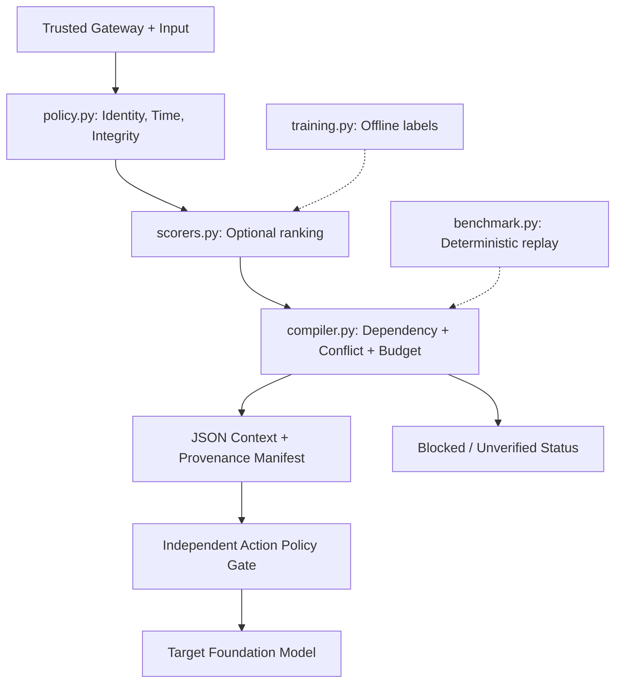

# Architecture decision 0001 — Compile evidence before model inference

## Caller usage

The caller presents a task, a **trusted** principal, evidence records, a token budget and explicit evidence requirements. It invokes `ContextCompiler.compile(request)`, then checks the returned status and the separate authorization decision for the requested action. No stateful infrastructure is necessary.

## Alternatives considered

1. **All-in-one context agent**: a large LLM retrieves, summarizes, authorizes, and builds prompts. Rejected for high inference cost and the absence of a reliable security boundary between data and model instructions.
2. **Pure retriever**: rank top-k evidence and concatenate. Retained as a baseline, but cannot express mandatory evidence, dependencies, source expiry, conflict metadata, or access-control decisions.
3. **Policy-first deterministic compiler with optional learned ranking** (**selected**): small deployment footprint, reproducible decisions, testable invariant checks, and separate security ownership. The trade-off is that semantic sufficiency must be learned and demonstrated independently.

## Module ownership

- `models.py` parses and validates typed records. Client-provided identity attributes have **no authenticated meaning** without a trusted gateway.
- `policy.py` owns access and integrity decisions; scoring never sees denied items.
- `scorers.py` owns ranking estimates only. Lexical and local linear modes are entirely offline; Cloudflare is an explicit network boundary.
- `compiler.py` owns transitive dependency closure, declared conflicts, requirement coverage, token-budget allocation and deterministic JSON output.
- `training.py` owns small CPU model fitting and portable JSON model storage; it does not execute during online requests.
- `benchmark.py` replays invariant and selection test cases; it does not claim to score LLM answer correctness.

## Invariants

1. No cross-tenant item can be selected or sent to any scorer.
2. A principal below an item's classification cannot access it.
3. A restricted item requires a positive ACL grant, even within the same tenant.
4. A scored item with inaccessible, expired, missing or conflicting *required dependencies* cannot be selected.
5. A required item plus its full dependency closure must fit within the budget; otherwise the compiler returns no context.
6. The model's scores may influence optional context ranking, **never** authorization or mandatory evidence requirements.
7. An absent set of declared requirements yields `unverified`, not an unjustified sufficiency guarantee.
8. Prompt content is serialized as untrusted JSON evidence; a downstream agent must not interpret it as a higher-priority instruction.

## Selection procedure

1. Enforce per-request input size and count ceilings.
2. Filter by tenant, principal clearance, optional subject/scope ACL, valid time range and digest.
3. If using a hosted scorer, check explicit egress policy and task classification. Never send an ineligible item externally. Run local ranking on the remaining authorized items above the egress ceiling.
4. Resolve all transitive dependency closures and reject invalid closures.
5. Add pinned records and choose the cheapest viable evidence alternatives for declared requirements, scoring by marginal byte-cost over relevance. Block if a requirement cannot be met.
6. Add optional evidence greedily by predicted score per marginal token, preserving dependency closure and declared conflicts.
7. Emit stable-sorted JSON content, approved provenance records, content digest, deferred eligible IDs and an honest coverage status.

**Complexity note:** selecting optimal evidence under a budget with overlaps, conflicts, and multiple alternatives is combinatorial. The v0.1 greedy compiler is deterministic and testable, not globally optimal. A future exact solver can be independently benchmarked when needed.

## Service boundary

For now CSE is a **library + CLI**, not a publicly accessible multi-tenant API. A production embedding must authenticate the caller, compute principal attributes from signed identity claims, fetch documents from an authorized repository, and verify digest values against a trusted manifest. No hidden model confidence can confer a permission or approve an external side effect.

## Operational characteristics

- Stateless execution, no queue, broker, vector store, GPU service, or database.
- Recompile on each relevant context update; new values or revocations do not mutate a past compiled bundle.
- The local linear model uses numeric JSON weights (no unsafe pickle load).
- Cloud scoring is optional and uses bounded request size and timeout; a provider failure falls back to an explicitly labelled lexical scorer, without changing security filtering.
- No secrets, raw context, or user content are logged by default.

## Principal risks

- Poor semantic relevance estimation may exclude vital but nonobvious evidence.
- `ready` checks **declared evidence IDs**, not actual factual completeness.
- Byte-based token estimates can differ from the downstream model tokenizer; integrate the exact tokenizer before imposing hard prompt-window limits.
- Dependency and conflict declarations can be missing or wrong.
- SHA-256 proves equality to a supplied digest, not source identity; the digest must be anchored in trusted ingestion.
- An authorized item can still contain malicious text, inaccurate evidence, or injected instructions.
